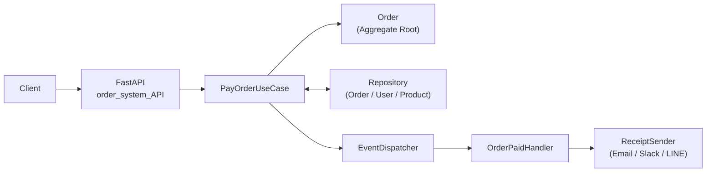

# Backend Practice


**「動くコード」ではなく「変更に強く、壊れにくいコード」を書けるようになること** を目標に、Pythonでバックエンド開発を学んでいる記録です。

基礎文法から始めて、ドメイン駆動設計（DDD）による注文管理システム、FastAPIによるWeb API、pytestによるテスト、NumPy / Pandasによるデータ分析まで、段階的に取り組んできました。

| | |
| --- | --- |
| 学習期間 | 2026年1月〜（継続中） |
| コミット数 | 179 |
| 学習ログ | `main.py` に日付ごとの学び・つまずき・設計判断を記録 |
| 代表作 | [注文管理システム](#注文管理システムorder_system)（DDD + FastAPI + pytest） |

---

## アピールポイント

**1. 責務分離を意識した設計**
「このロジックは誰の責任か」を基準にコードの置き場所を決めています。ドメイン（業務ルール）・ユースケース（処理の流れ）・インフラ（保存・送信）を分け、依存の向きを Domain ← Application ← Infrastructure に揃えました。

**2. 不整合を起こさない実装**
状態遷移をテーブルに集約し、二重支払い・二重キャンセルを防止。「チェック → 副作用 → 状態確定」の順序を守ることで、途中で失敗しても状態が壊れないようにしています。

**3. テストで振る舞いを確認する習慣**
正常系だけでなく、存在しない注文、残高不足、在庫不足といった異常系もテストしています。`fixture` でテストごとにデータを初期化し、テスト同士が影響し合わないようにしています。

**4. 学習を継続して記録する習慣**
毎回の学習内容を日付つきで残し、理解した点と設計の判断理由を言葉にして整理しています。

---

## 注文管理システム（`order_system/`）

注文の作成から支払いまでを扱うシステムです。永続化はインメモリ実装ですが、リポジトリを抽象化してあるため、DB実装への差し替えを想定した構造にしています。



### 使っている設計

| 設計 | 内容 |
| --- | --- |
| 集約（Aggregate） | `Order` を集約ルートとし、状態変更は `Order.pay()` などを通してのみ行う |
| 値オブジェクト / エンティティ | `OrderId` などの値オブジェクトと、IDを持つエンティティを区別 |
| 状態遷移 | `Enum` で状態と操作を型安全に表現し、許可される遷移を `ALLOWED_TRANSITIONS` に集約 |
| ドメインイベント | 支払い完了時に `OrderPaid` を発行し、レシート送信などの副作用をドメインの外へ分離 |
| リポジトリパターン | 抽象クラスと `InMemory*Repository` で保存先を抽象化 |
| 依存の抽象化 | `ReceiptSender` をインターフェースにし、送信方法をポリモーフィズムで差し替え可能に |
| ドメイン例外 | `InsufficientBalanceError`、`OutOfStockError` など、業務上の失敗を専用の例外で表現 |

### 設計判断と理由

- **状態チェックを `if` 文からテーブル駆動へ**: 許可される遷移が1か所にまとまり、状態が増えても修正箇所が散らばらない
- **状態遷移は処理の最後に行う**: 副作用が失敗したときに「状態だけ進んでいる」不整合を防ぐ
- **1トランザクション = 1集約**: 整合性を守る範囲を集約の内側に限定する
- **副作用をイベントで分離**: 支払いロジックを変えずに、通知手段の追加・変更ができる
- **`None` と例外の使い分け**: 「結果がなくても自然な場合」は `None`、「データの不整合など成立しない状態」は `ValueError` を送出する

### API

| メソッド | パス | 説明 | 主なレスポンス |
| --- | --- | --- | --- |
| `GET` | `/orders/{order_id}` | 注文の詳細を取得 | `200` / 存在しない場合 `404` |
| `POST` | `/orders` | 注文を作成（body: `order_id`, `user_id`, `product_id`） | `200` |
| `POST` | `/orders/{order_id}/pay` | 注文を支払う | `200` / 存在しない場合 `404` / 残高不足・在庫不足は `400` |

### テスト

`TestClient` を使ったAPIテストを7件用意しています（`main.py`）。

- 注文の取得（成功 / 存在しない注文）
- 注文の作成
- 支払い（成功 / 存在しない注文 / 残高不足 / 在庫不足）

---

## 技術スタック

| カテゴリ | 技術・ツール |
| --- | --- |
| 言語 | Python 3.10+ |
| Web API | FastAPI, Pydantic, Uvicorn, `asyncio` |
| 設計 | ドメイン駆動設計（DDD）、オブジェクト指向設計、レイヤードアーキテクチャ |
| テスト | pytest, FastAPI `TestClient` |
| データ分析 | NumPy, Pandas, Matplotlib |
| 開発環境 | VS Code, Cursor, Git / GitHub |

---

## その他の学習内容

| ディレクトリ | 内容 |
| --- | --- |
| `fastapi_practice/` | FastAPIの演習（ルーティング、クエリパラメータ、リクエストボディ、ヘッダー、非同期処理） |
| `python_fundamentals/` | 基礎文法、型ヒント、クラス設計、例外設計 |
| `data_analysis/` | NumPy / Pandas / Matplotlib によるデータの加工・集計・可視化 |
| `sql_practice/` | SQLの演習 |
| `python_reference.py` | リファレンス・検証用コード |

---

## セットアップ

Python 3.10 以上が必要です。

```bash
git clone https://github.com/yukioishi-eng/backend-practice.git
cd backend-practice

python -m venv .venv
source .venv/bin/activate        # Windows: .venv\Scripts\activate

pip install fastapi uvicorn pydantic pytest httpx
pip install numpy pandas matplotlib japanize-matplotlib   # data_analysis を動かす場合
```

APIの起動:

```bash
uvicorn order_system.order_system_API:app --reload
```

起動後、`http://127.0.0.1:8000/docs` でSwagger UIからAPIを試せます。

テストの実行:

```bash
pytest main.py
```

---

## 学習の流れ

| 時期 | テーマ | 学んだこと |
| --- | --- | --- |
| 2〜3月 | Python基礎・ドメイン設計 | `Optional` と例外の使い分け、型ヒント、`@property` によるカプセル化、責務分離、状態遷移、ドメインイベント、リポジトリパターン |
| 4〜7月 | データ分析 | NumPy、Pandas（結合・集計・`map()`）、Matplotlib での可視化 |
| 8〜10月 | Web API | FastAPI、非同期処理、注文APIの実装、`TestClient` + `pytest` によるAPIテスト |

---

## 今後の課題

- インメモリのリポジトリをDB実装に差し替える
- テストを `tests/` ディレクトリに整理する

---

## ディレクトリ構成

```
backend-practice/
├── order_system/          # DDDによる注文管理システム
│   ├── order_system_v5.py     # ドメイン・ユースケース・リポジトリ
│   └── order_system_API.py    # FastAPIアプリ
├── fastapi_practice/      # FastAPIの演習
├── python_fundamentals/   # Pythonの基礎
├── data_analysis/         # データ分析
├── sql_practice/          # SQLの演習
├── main.py                # 学習ログ + APIテスト
├── python_reference.py    # リファレンス・検証用コード
└── README.md
```
